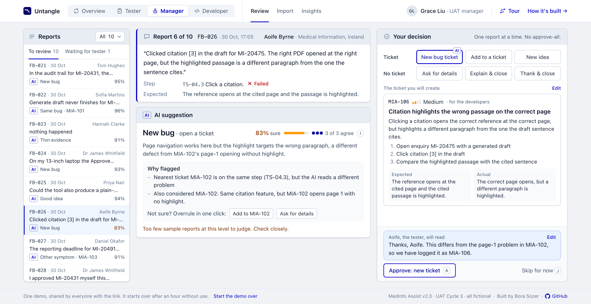
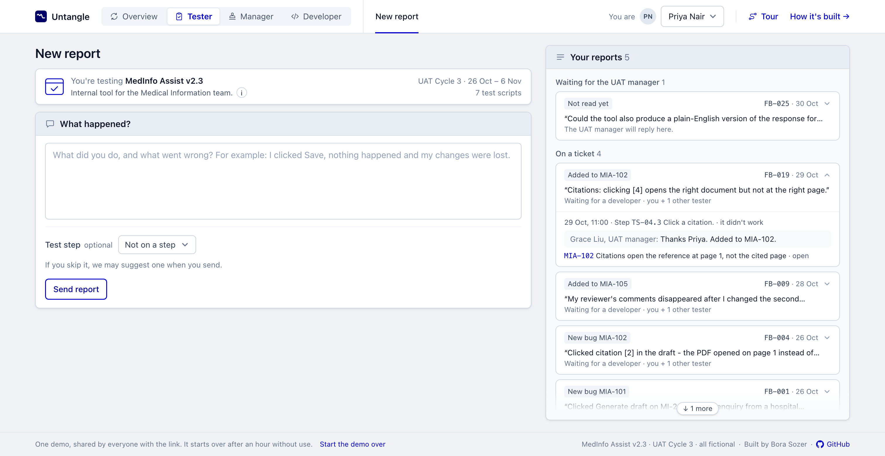
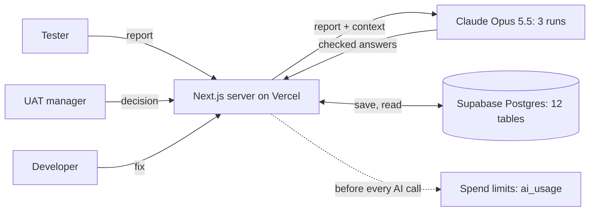

# Untangle

Triage for user acceptance testing (UAT) feedback. Testers write what went wrong in their own words; they send reports, not tickets. For each report Claude suggests what it is, which ticket it belongs to and how sure it is, with its reasons. A person decides every report, one at a time: a new ticket, one more report on an existing ticket, an idea, a question back or a reply. Every tester hears back.

**Live demo:** https://uat-untangled.vercel.app

Everything in the demo is fictional: "MedInfo Assist" is a made-up tool that drafts answers to medical information enquiries, and all people, products and reports are invented.





## Try it in 60 seconds

1. Open **Manager**. FB-021 is a tester's report of a new audit-trail bug, and two more reports describe the same bug. Approve it: it becomes a new ticket (MIA-106 in a fresh demo), and the next report on the same bug opens by itself, already pointing at it.
2. Open **FB-026**. The AI is only 83% sure that this is a new bug, and says why. If you judge it part of MIA-102, "Add to MIA-102" overrules it in one click; the change is recorded.
3. Follow "See what Aoife sees" to the tester's side.
4. Open **Developer** → MIA-101 → "Mark fixed". Then **Tester** → Priya Nair → "It works now", and watch the ticket list.

Everyone who opens the link shares one demo. "Start the demo over" at the bottom of every page puts it back at the start, and it starts over by itself after an hour without use.

New here? **Tour**, at the top right, walks through the four views in 14 short steps without changing anything.

## Where to look

| | Where |
|---|---|
| Duplicates, known issues, thin reports and ideas told apart | Review: every report lands in one bucket (Same bug, Other symptom, Already known, Thin evidence, Good idea, New bug, Works as designed, A question, Nothing to fix); a menu above the queue gives each bucket's count and shows a single bucket |
| A person decides every report | Review: one report at a time, no approve-all; a change to the AI's suggestion is recorded |
| Reasons, not only an answer | Review: Why flagged, a confidence figure from three separate runs, and (behind the (i)) how often that range was right when measured |
| Three people, one loop | Tester, Manager and Developer views: report, decision, ticket, fix, retest |
| Trends across the cycle | Insights: day by day (what each report became), problems per test script, how sure is sure |

## What it does

The header switches between four views: **Overview**, **Tester**, **Manager** and **Developer**. There is no sign-in; each view shows one person's side of the same test cycle.

- **New report** (tester). A small box says what is being tested (the app, the cycle and its dates). The tester writes what happened in their own words. The test step is optional: a list of the test scripts, each step with what should happen, lets them pick it and say whether it worked. If they skip it, the quick check that runs before sending suggests the step ("Was this test step TS-04.3: Click a citation?"), and it is saved only if the tester says yes. The same check looks for missing evidence: if the report cannot be acted on, the tester gets one specific question, such as "Did the banner not appear, or did the import not start?". They can always skip it and send, and the check gives up after 12 seconds. "Your reports" is a box of its own, in four groups (Your turn, Waiting for the UAT manager, On a ticket, Done). Each card says where the report stands ("Not read yet", "New bug MIA-101", "Fixed: please check") and what happens next ("Ravi is fixing it · you + 3 other testers"); a click shows the step, the manager's reply and the ticket. A question to answer or a fix to retest is always open.
- **Review** (UAT manager). Reports come one at a time ("Report 2 of 10"). Each one comes with a suggestion:
  - the outcome in plain words: Same bug, Other symptom, Already known, Thin evidence, Good idea, New bug, Works as designed, A question, Nothing to fix;
  - **Why flagged**: facts the app knows for certain first (same test step as the ticket, other reports in the queue that describe the same problem), then what the AI read in the words; the ticket's own card shows how many reports and testers it already has;
  - a confidence figure with a bar and how many runs agree; the (i) beside it says how the figure was worked out and how often suggestions in that range were right on labelled data, and a line under the suggestion appears only when the figure needs a closer look;
  - **Overrule in one click**: the most likely alternatives, one click each.

  After a decision, the next report about the same problem opens by itself. The approve button says what it will do ("Approve: add to MIA-101"), and the decision shows what approving creates and the message the tester will read, with the real ticket number. A change to the AI's suggestion is recorded and says so. There is deliberately no "approve all" button, and nothing is created until a person approves.
- **Import.** A test run exported as CSV is analysed row by row, including rows marked Pass, which often hide bugs or ideas. An uploaded file is checked first: the columns found, and what will not be understood (testers not in the cycle, unknown test steps, unreadable dates), before anything is created or sent to the AI. When several rows describe the same new problem, the first one proposes the ticket and the others link to it. When it finishes, a summary says what the AI suggests ("32 rows → 6 new problems (14 rows) · 3 for existing tickets · …"); nothing is created until a person decides each row in Review. A row whose analysis fails can be tried again.
- **Tickets** (developer). One ticket per problem, most severe first, with every tester report as evidence and the decision behind each. A **For Jira** box fills Jira's own fields (summary, issue type, priority, environment, component, labels, and a plain-text description with steps, test data, the testers' words and, once fixed, the retest result): a click on a field copies it, "Copy all" copies them all; nothing is sent to Jira. The developer picks a ticket up and marks it fixed; every tester who reported it is asked to retest, once each, and "Still broken" asks for one line on what happened. When all of them say it works, the ticket shows "Confirmed by every tester". Nothing closes or reopens by itself.
- **Insights.** One sentence for the whole cycle. Day by day: when reports came in and what each became, with each outcome's share. Where the problems are, by test script, with the tickets they joined. At each confidence level, how often the AI was right on the labelled data (and on reports never used to tune it), and how often the manager kept its suggestion in this demo.

## How it's built

**How it's built →**, at the top right of every page, opens the same picture in the app, follows one sample report (FB-021) from the tester's words to a fix, and shows why to trust a suggestion: 56 of 57 right on the labelled samples, 15 of 15 on reports never used for tuning.



The browser talks only to the Next.js server; the database key and the Anthropic key stay there. The 12 tables, in five groups: test plan (`cycles`, `scripts`, `steps`, `app_rules`, `people`), reports (`feedback`, `batches`), AI (`analyses`, `ai_usage`), decisions (`decisions`) and work (`tickets`, `ticket_events`).

## How the AI works

1. **Context.** The prompt contains the cycle's rules (what is by design), the test scripts and their expected results, every ticket with a few example reports, and the reports still waiting for a decision.
2. **Three separate runs.** The same report is analysed three times in parallel with the same model and prompt (Claude Opus 5.5, structured output validated with Zod).
3. **Confidence.** The figure is half how many of the three runs agreed and half how sure they said they were. If the AI would act on a report whose evidence is too thin to act on, the figure is capped at 50%; when it asks the tester instead, the figure is how sure it is that asking is right.
4. **Calibration.** On a labelled set of reports, the app measured how often suggestions in each confidence range were right. The (i) next to the figure shows that measured rate, or says when a range has too few cases to judge.

The AI never changes anything by itself. Tickets, links and messages to testers exist only after a person approves them.

## Measured results

Measured on 57 labelled sample reports. Each report was judged against the existing tickets. A report that originally created a ticket was judged with that ticket hidden, so the AI had to propose it from scratch.

| | Result |
|---|---|
| Correct decision | 56 of 57 (98%) |
| Correct category | 57 of 57 |
| Suggestions at 85-95% confidence | 36 of 36 right |
| Suggestions at 95-100% confidence | 20 of 20 right |
| The one miss | 78% confidence; the AI asked the tester instead of linking |
| Live import of 32 rows | 32 of 32 acceptable, 11 of 12 new problems grouped into one ticket, about 1 minute, about $0.08 per row |
| Evidence judged right (complete, partial or not enough to act on) | 49 of 57 |
| Held-out check: 15 new reports | 15 of 15 right (category 15 of 15, evidence 14 of 15), $1.13 |
| Suggested test step, when the tester picks none (`npm run eval:step`, on the 41 labelled reports) | 33 of 37 right (12 of 12 held-out); 1 the right script but a neighbouring step; 3 no suggestion (two vague reports and an idea); none in the wrong script. Of 4 reports written without a step, 1 got no suggestion and 3 got one for the tester to confirm or turn down (FB-029, the same audit-trail bug as FB-028, got its step). The check's questions never name a step id; $0.13 |

All three runs agreed on every one of the 57 reports, so on this set the confidence figure moved only with the runs' own estimates; the one miss was also the only suggestion below 85%.

These figures show that the system behaves as designed on its sample data. They are not a claim about real-world accuracy: the sample reports and their labels were written together, and the same reports were used to tune the prompt.

The held-out check is a small step past that. Fifteen new reports (`data/sample/holdout-cycle3.json`) were written and labelled by a separate AI agent that saw only the app's description, rules, test steps, tickets and testers, never the triage prompt or the sample reports. They were never used to tune anything. Fifteen is too few to quote a rate, so the app shows the count only. With real data, rerun `npm run eval` on a labelled sample first. The calibration table updates automatically.

## Cost and abuse protection

The demo is public, so every AI call the website makes is written to a spend ledger (`ai_usage`) with its cost. Before each call, the app checks three budgets:

- the last 24 hours: $10 by default ($20 on the live demo);
- all time: $60;
- the same visitor in the last hour: $6 by default ($10 on the live demo).

A failed call still counts, at a cautious estimate, so a bug that keeps retrying stops when it reaches the budget. Other safeguards:

- The importer checks the budget for every row before it imports anything, and takes at most 60 rows at a time.
- A report is analysed when it arrives, and again only after its tester answers a question; retrying a failed analysis works only while the report has no suggestion.
- Pages stop refreshing themselves after three minutes.
- API retries and timeouts are capped.

Visitors are identified by a short hash of their IP address; the address itself is not stored.

## The shared demo

Everyone who opens the link uses the same demo. Anyone can start it over from the home page, and it starts over by itself after an hour without use, so a later visitor finds it in its starting state. Starting over makes no AI calls: the starting suggestions are saved. A daily cron job (`/api/keep-alive`, read only) keeps the free database from pausing after a quiet week.

## Running it

You need Node 20 or later, a Supabase project, an Anthropic API key and the Supabase CLI (for migrations).

```bash
npm install
cp .env.example .env.local   # fill in the values
npm run db:push              # create the tables
npm run seed                 # load the sample cycle
npm run dev                  # http://localhost:3000
```

The browser never talks to the database. All queries run on the server with Supabase's secret key, and row level security is on for every table.

Pages start the shared demo over when it has been left changed and idle (see above). If a local server shares its database with a live demo, start it with `DEMO_AUTORESET=off` so that opening a page only reads; buttons still write. `npm run seed -- --fresh` followed by `npm run analyse:pending` should run back to back while nobody uses a live demo on the same database, or the live site will restore the saved suggestions first.

| Script | What it does |
|---|---|
| `npm run seed` | Resets the database to the sample cycle (add `-- --fresh` to skip the saved AI suggestions) |
| `npm run analyse:pending` | Analyses every report that has no suggestion yet (uses API credit) |
| `npm run eval` | Measures accuracy on the 57 labelled reports and writes the calibration table (uses API credit, about $3.30) |
| `npm run eval:step` | Measures how often the quick check suggests the right test step when the tester picks none (uses API credit, about half a cent per report) |
| `npm run eval:holdout` | Measures accuracy on the 15 held-out reports and writes `data/holdout.json`; the calibration table is left alone (about $1.10) |
| `npm run check:batch` | Compares the latest import with its labels |
| `npm test` | Unit tests for the retest loop, buckets, CSV import, the shared demo, calibration, the tester's report cards, ticket numbers and the step suggestion (no database or API) |
| `npm run smoke` | End-to-end test of the decision flow (resets the data) |
| `npm run snapshot` | Saves the current suggestions so a reset restores them without API calls |

## Using your own data

- **Spreadsheets:** the importer recognises common column names, such as `ID`, `Tester`, `Test Step`, `Result`, `Comments` and `Date` (and alternatives like `Description` or `Pass/Fail`). Steps can be written as `TS-04.3`, `TS04.3` or `TS-04 step 3`.
- **A different cycle:** replace `data/sample/medinfo-cycle3.json` with your own scripts, steps, rules and tickets, then run `npm run seed`. Nothing about MedInfo Assist is in the code apart from a few things taken from this sample cycle: two worked examples in the prompt, the pattern a ticket page uses to spot test data (enquiry and e-mail ids), the ids of the manager and the developer (`M1`, `D1`), the report "How it's built" follows (FB-021) and the stops of the tour (T1, FB-026, MIA-101). The app's name, description and dates, its test scripts, rules, tickets and people are all data, and new ticket numbers follow the cycle's own prefix. Another app's cycle works on the same screens if it keeps a manager `M1` and a developer `D1`; the tour and "How it's built" would need examples of its own.

## Project layout

```
src/app/            pages, server actions and the per-row analysis endpoint
src/lib/ai/         prompt, Claude call, aggregation, calibration, spend budget
src/lib/            database access, decisions, the developer loop, CSV import, seeding, the shared demo
supabase/migrations database schema
data/sample/        fictional cycle, labelled CSV, saved suggestions
scripts/            evaluation and maintenance scripts
```

## Reading the code

One report's path through the code, in the order it happens:

1. **The tester writes it.** `src/app/tester/tester-app.tsx` is the form and the tester's list. Before sending, a quick check (`checkEvidenceAction` → `src/lib/ai/evidence.ts`, one short Claude call that gives up after 12 seconds) may suggest the test step or ask one question. `submitFeedbackAction` in `src/app/actions.ts` checks the length and the spending limits, saves the report, and starts the analysis after the response has gone back to the tester.
2. **The AI reads it.** `src/lib/ai/analyse.ts` loads the cycle (`context.ts`: rules, test steps, tickets with example reports, reports still waiting), builds the prompt (`prompt.ts`; its fixed part is cached) and calls Claude three times in parallel (`claude.ts`, answers checked against the Zod schema in `schema.ts`). It combines the three runs into one suggestion and a confidence figure, looks up how often that range was right (`calibration.ts`, from `data/calibration.json`), and stores everything. The cost of every call the website makes goes to the spend ledger (`budget.ts`).
3. **The UAT manager decides it.** `src/app/review/page.tsx` loads the queue (`getQueue` in `src/lib/queries.ts`); `src/app/review/review-desk.tsx` is the whole Review screen. Approving calls `decideAction`, and `decide()` in `src/lib/decide.ts` is the only place the app writes a decision (the seed loads the sample cycle's earlier ones): the ticket, link, idea, question or message, and a record of what the AI suggested and whether a person changed it.
4. **The developer fixes it.** `src/app/tickets/page.tsx` lists the tickets; `src/app/tickets/[key]/page.tsx` shows one, with `dev-panel.tsx` (pick up, mark fixed, reopen) and `jira-fields.tsx` (the copy for Jira). Each step is one function in `src/lib/ticket-work.ts`.
5. **The tester hears back and retests.** `src/lib/tester-status.ts` decides how each report reads on the tester's list ("Your turn", "Waiting for a developer", …); "It works now" and "Still broken" go through `retestAction` to `recordRetest`.

Elsewhere:

- `src/app/insights/page.tsx`: the cycle's trends and how far to trust the AI.
- The importer: `src/app/import/importer.tsx` → `importCsvAction` → `src/lib/importer.ts` (with `import-plan.ts` and `csv.ts`). Each row is then analysed through `src/app/api/analyse/route.ts`, one request per row and four at a time, so the screen can show progress.
- The shared demo: `src/lib/demo.ts` and `src/lib/seed.ts`.
- The guided tour (`src/components/tour/`) and the "How it's built" window (`src/components/how-its-built.tsx`).
- The unit tests sit next to what they test (`src/lib/*.test.ts`, `src/lib/ai/*.test.ts`).

## Built with

Next.js 16 (App Router, server actions), React 19, Tailwind CSS 4 and Headless UI; Supabase (Postgres); Claude Opus 5.5 through the Anthropic SDK, with structured output checked by Zod; hosted on Vercel. Built with Claude Code as a coding assistant.

## In a regulated setting

- **Audit trail.** Every decision is stored with the AI's suggestion beside it: the outcome, what the AI suggested, whether a person changed it, who decided and when. Every analysis keeps the model, the prompt version, all three runs, the cost and the time taken.
- **What the AI sees.** The report's text, the tester's name and team, the test steps and rules, the tickets and the reports still waiting. No patient data is needed, but free text could contain some: a real deployment would remind testers, redact before sending, and reach Claude through the company's approved route.
- **Still missing for a validated (GxP) system.** Sign-in and roles, electronic signatures, a reason recorded with each overrule, an audit trail that cannot be reset (the demo's can), and validation on real, human-labelled UAT data.
- **Changing the model.** The model is one setting (`AI_MODEL`); `npm run eval` measures a new one on the same labelled reports before it is switched.

## Limitations and next steps

- There is no sign-in: the tester view has a persona picker. A real deployment would use the company's single sign-on and roles.
- Testers cannot attach screenshots yet. A real deployment needs file storage and a way for the AI to read images.
- Jira is filled by copy and paste, not through its API.
- The app handles one test cycle at a time. Choosing between several apps or cycles on screen is the next step; scripts, steps and ticket keys would then need to be unique per cycle, not across all of them.
- Every ticket goes into the prompt. With thousands of tickets, a search step should shortlist candidates first.
- Tester text could try to manipulate the AI. It is quoted in the prompt as the tester's words (not isolated from it), the model only suggests, and a person approves every decision.

## Author and licence

Built by Bora Sozer, November 2026. MIT licence (see `LICENSE`).
